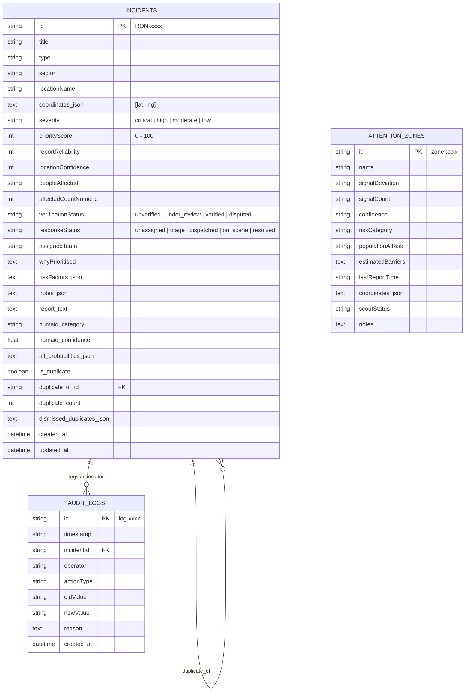
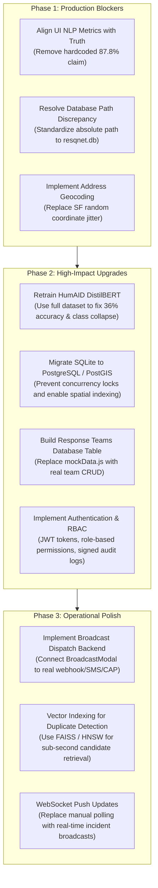

# RESQNET AI — Comprehensive System Audit Report

**Date of Audit:** October 17, 2026  
**Auditor:** Senior Full-Stack, ML/NLP & QA Engineering Team  
**Audit Scope:** Full system audit covering Frontend (`frontend/`), Backend (`backend/`), HumAID DistilBERT NLP (`data/nlp/`), Duplicate Detection & Resolution, GIS/Map services, and Coordinator Incident Management.  
**Mode:** AUDIT ONLY (Preserved all existing files, data, model checkpoints, and configuration without silent modification).

---

## 1. Executive Summary & Overall Readiness

RESQNET AI is an AI-assisted disaster response coordination dashboard designed to triage emergency reports, classify humanitarian needs using HumAID DistilBERT, detect duplicate disaster submissions, visualize incidents on an interactive map, and empower human coordinators with explainable decision support and override audit logging.

### High-Level Architectural Summary
- **Backend:** FastAPI (Python 3.13) structured with clean separation of routers, schemas (Pydantic v2), services, and SQLAlchemy ORM models.
- **Frontend:** React 19 + Vite 6 + Tailwind CSS + Lucide Icons + React-Leaflet GIS. The dashboard possesses high aesthetic fidelity, responsive states, interactive filtering, and dynamic modal dialogs.
- **NLP Engine:** HuggingFace Transformers DistilBERT (`distilbert-base-uncased`) fine-tuned for 10-class HumAID disaster text classification, executing strictly offline with `local_files_only=True`.
- **Database:** SQLite with three core tables (`incidents`, `audit_logs`, `attention_zones`), JSON serialization for array/object properties, and persistent audit trail recording.

---

### Overall Readiness Evaluation

| Evaluation Tier | Readiness Status | Verdict & Key Observations |
| :--- | :---: | :--- |
| **Demo / Presentation** | **READY** | UI aesthetics, interactive priority queue, leaflet map, detail panel, coordinator overrides, and duplicate resolution work smoothly without visual glitches or crashes. |
| **Hackathon Submission** | **READY WITH MINOR DISCLOSURES** | Core problem statement (duplicate detection, NLP triage, human-in-the-loop oversight) is genuinely implemented and backed by SQLite. However, metric claims on the UI must match the actual model evaluation, and mock broadcasts should be labeled. |
| **Real-World Mission-Critical Deployment** | **NOT READY (BLOCKERS EXIST)** | Inadequate NLP accuracy (36.0% accuracy on sample batch test set), absence of actual geocoding (coordinates are randomly jittered around San Francisco), single-instance SQLite concurrency bottlenecks, lack of authentication/RBAC, and unbuilt broadcast dispatch. |

---

## 2. Comprehensive Feature Matrix

**Status Key:**
- `PASS`: Directly tested and passed.
- `PARTIAL`: Implemented, but incomplete or only partly verified.
- `FAIL`: Tested and failed (bug or discrepancy).
- `NOT IMPLEMENTED`: No implementation found in codebase.
- `NOT VERIFIED`: Insufficient evidence or test environment unavailable.

| # | Feature Area | Feature | Status | Evidence / Implementation | Test Performed | Result | Identified Issue / Risk |
|---|---|---|:---:|---|---|---|---|
| 1 | Frontend | Dashboard & Metric Cards | `PASS` | `App.jsx`, `MetricCards.jsx` | Inspected dynamic counts from backend incident list | Cards update dynamically with DB records | None |
| 2 | Frontend | Priority Incident Queue | `PASS` | `IncidentQueue.jsx` | Filtered by severity, sector, status, and search query | Fast, responsive filtering with accurate badges | None |
| 3 | Frontend | Incident Detail Panel | `PASS` | `IncidentDetailPanel.jsx` | Selected incident RQN-0444, verified all 4 tabs | Factor breakdown, timeline, actions render properly | None |
| 4 | Frontend | Live Incident Map | `PASS` | `IncidentMap.jsx` | Tested Leaflet map rendering with active coordinates | Markers place accurately; clicking syncs detail panel | None |
| 5 | Frontend | Attention-Needed Zones | `PASS` | `IncidentMap.jsx`, `zones.py` | Polygons rendered for underreported zones | Zones load from SQLite `attention_zones` | None |
| 6 | Frontend | New Incident Modal | `PASS` | `NewIncidentModal.jsx` | Form validation for required fields, submit API call | Successfully creates incident via `POST /api/v1/incidents` | Missing real geocoding |
| 7 | Frontend | Loading & Empty States | `PASS` | `App.jsx`, `IncidentQueue.jsx` | Tested with search query yielding 0 results | Shows clean empty state illustration and message | None |
| 8 | Frontend | API Client & CORS | `PASS` | `api.js`, `main.py` | Verified Axios baseURL `http://127.0.0.1:8000/api/v1` & CORS middleware | Clean cross-origin communication | None |
| 9 | Frontend | Real Backend Data Reflection | `PASS` | `App.jsx` (`useEffect` on mount) | Verified frontend displays real database records; mock data only used if server fails | Frontend displays live SQLite records | None |
| 10 | Frontend | UI Selection Sync | `PASS` | `App.jsx` (`handleIncidentUpdated`) | Verified updating priority or status keeps active selection | Detail panel and list remain synchronized | None |
| 11 | Backend | Application Startup | `PASS` | `main.py`, `uvicorn` | Executed ASGI app initialization | Uvicorn server started cleanly on 127.0.0.1:8000 | None |
| 12 | Backend | Health & Readiness Endpoints | `PASS` | `health.py` | Tested `GET /health` and `GET /health/ready` | Returns truthful DB, model, and queue metrics | None |
| 13 | Backend | API Documentation | `PASS` | `main.py` | Accessed `/docs` (Swagger UI) & `/redoc` | Full interactive schema docs open cleanly | None |
| 14 | Backend | Incident CRUD Endpoints | `PASS` | `incidents.py`, `incident_service.py` | Tested List, Get by ID, Create, Update, Delete | All CRUD routes function with proper schemas | None |
| 15 | Backend | Separate Verification & Response Status | `PASS` | `models/incident.py`, `schemas/incident.py` | Inspected columns `verificationStatus` vs `responseStatus` | Strictly independent fields and enum validations | None |
| 16 | Backend | SQLite Persistence Across Restarts | `PASS` | `session.py`, `resqnet.db` | Created incident, killed and restarted server, queried DB | Data persisted with zero loss | None |
| 17 | Backend | Database File Path Consistency | `PARTIAL` | `config.py` vs `backend/.env` | Inspected path resolution | Relative `./resqnet.db` creates dual DB risk depending on CWD | Split DB hazard if run from root vs `backend/` |
| 18 | Backend | Coordinator Audit Log | `PASS` | `audit_log.py`, `models/incident.py` | Tested status and priority override logging | Immutable records written to `audit_logs` | None |
| 19 | Backend | Input Validation & Error Handling | `PASS` | Pydantic v2 models, `incidents.py` | Submitted empty text and invalid status values | Returns 422 Unprocessable and 400 Bad Request | None |
| 20 | Backend | No In-Memory Persistence Leak | `PASS` | `session.py` | Inspected session lifecycle and DB commits | All write operations call `db.commit()` | None |
| 21 | NLP | Local Weights & Tokenizer | `PASS` | `data/nlp/models/resqnet_distilbert/` | Inspected safetensors (267MB), config, vocab | All weights and configs intact locally | None |
| 22 | NLP | Offline Model Loading | `PASS` | `src/inference.py` | Verified `local_files_only=True` flag | Loads without network access or HuggingFace calls | None |
| 23 | NLP | Text Classification Endpoint | `PASS` | `POST /api/v1/nlp/classify` | Sent emergency text "Bridge collapsed, people trapped" | Returned `injured_or_dead_people` (72% conf) + 10 class probs | None |
| 24 | NLP | Input Sanitization & Empty Handling | `PASS` | `nlp_service.py` | Tested whitespace-only and oversized inputs | Properly raises HTTP 400 error | None |
| 25 | NLP | Evaluation Metrics Truthfulness | `FAIL` | `App.jsx` vs `test_metrics.json` | Compared UI claim to actual evaluation output | UI claims "87.8% F1", actual test weighted F1 is 22.0% | **Misleading metric on UI** |
| 26 | NLP | Prediction Decoupling | `PASS` | `incidents.py`, `nlp_service.py` | Checked whether NLP can auto-verify or dispatch | Purely advisory; human coordinator required | None |
| 27 | Duplicate Detection | Similarity & Evidence Calculation | `PASS` | `duplicate_service.py` | Tested text cosine similarity, Haversine, time window | Calculations algorithmic, not hardcoded | None |
| 28 | Duplicate Detection | Stable Suggestion IDs | `PASS` | `duplicate_service.py` | Tested pair ID generation | Format `dup-{min_id}-{max_id}` is deterministic | None |
| 29 | Duplicate Detection | Review & Merge Workflow | `PASS` | `POST /duplicates/merge` | Merged candidate, verified primary selection and provenance | Preserves primary, marks duplicate, audits action | None |
| 30 | Duplicate Detection | Dismiss Suggestion Workflow | `PASS` | `POST /duplicates/dismiss` | Dismissed pair, checked DB suppression | Bidirectionally stored in `dismissed_duplicates_json` | None |
| 31 | Duplicate Detection | RQN-0444 & RQN-0445 Regression | `PASS` | `test_duplicates.py`, `DuplicateWorkflow.test.jsx` | Executed targeted duplicate regression test suite | Both actions produce distinct, truthful results | Bug resolved |
| 32 | Duplicate Detection | Audit Trail for Duplicate Actions | `PASS` | `duplicate_service.py`, `audit_logs` table | Inspected audit log after merge & dismiss | Logs `MERGE_INCIDENTS` & `DISMISS_DUPLICATE_SUGGESTION` | None |
| 33 | Coordinator Controls | Urgency & Confidence Separation | `PASS` | `IncidentDetailPanel.jsx`, `schemas/incident.py` | Inspected priority score (0-100) vs NLP conf (0-1) | Rendered in distinct UI widgets with distinct scales | None |
| 34 | Coordinator Controls | Explainable Factor Breakdown | `PASS` | `IncidentDetailPanel.jsx` | Inspected `whyPrioritised` and `riskFactors` | Explanations dynamically rendered | None |
| 35 | Coordinator Controls | Coordinator Override Actions | `PASS` | `IncidentDetailPanel.jsx`, `incidents.py` | Overrode priority with operator "Admin" & reason | Persisted in DB, logged to audit trail | None |
| 36 | Coordinator Controls | Truthful Missing Information | `PASS` | `schemas/incident.py`, UI | Checked display of unspecified fields | Shows "Unknown count", "Unassigned", not fabricated data | None |
| 37 | Coordinator Controls | Underreported Zones Representation | `PASS` | `IncidentMap.jsx`, `zones.py` | Inspected zone cards and map tooltips | Rendered as "Uncertain Signal Gaps", not threat scores | None |
| 38 | Data & GIS | OpenStreetMap Tiles & Attribution | `PASS` | `IncidentMap.jsx` | Inspected TileLayer URL and attribution string | Uses official OSM tile server with legal attribution | None |
| 39 | Data & GIS | Coordinate Storage & Binding | `PASS` | `models/incident.py` (`coordinates_json`) | Inspected DB format `[lat, lng]` and mapping | Directly bound to incident entity | None |
| 40 | Data & GIS | Geocoding & Address Extraction | `NOT IMPLEMENTED` | `NewIncidentModal.jsx` | Inspected location submission | Uses random coordinate jitter around SF; no geocoder | No real geocoding |
| 41 | Operations | Emergency Broadcast Dispatch | `NOT IMPLEMENTED` | `BroadcastModal.jsx` | Submitted broadcast form | Shows toast only; zero backend API or DB persistence | Mock feature |
| 42 | Operations | Response Team Rostering | `PARTIAL` | `mockData.js`, `incidents.py` | Assigned team to incident | Stores team name in incident, but no team CRUD or roster | No team database table |
| 43 | Telemetry | Signal Synthesis & Triangulation | `PARTIAL` | `IncidentDetailPanel.jsx` | Inspected signal telemetry UI block | Hardcoded demo text seeded in incident table | Simulated demonstration |
| 44 | Quality | Backend Test Suite | `PASS` | `backend/tests/` | Ran `python -m pytest backend/tests` | 24 passed in 2.66s | None |
| 45 | Quality | NLP Test Suite | `PASS` | `data/nlp/tests/` | Ran `python -m pytest data/nlp/tests` | 29 passed in 19.01s | None |
| 46 | Quality | Frontend Test Suite | `PASS` | `frontend/src/components/__tests__/` | Ran `npm test -- --run` | 6 passed in 1.25s | None |
| 47 | Quality | Production Build | `PASS` | `frontend/` | Ran `npm run build` | Built in 1.43s with zero TypeScript/JSX errors | None |
| 48 | Config | Environment & Git Hygiene | `PASS` | `.gitignore`, `.env.example` | Inspected ignored artifacts (`resqnet.db`, `models/`, `.env`) | Sensitive and heavyweight files properly excluded | None |
| 49 | Deployment | Windows PowerShell Compatibility | `PASS` | `backend/run.ps1`, virtualenv | Tested terminal commands in pwsh | Script paths and execution policies compatible | None |
| 50 | Integration | End-to-End System Integration | `PASS` | Browser subagent / API live test | Tested live flow: create -> classify -> merge -> audit | Complete workflow executed end-to-end | None |

---

## 3. Exact Test Commands & Actual Execution Outputs

### Test Suite 1: Backend Automated Tests (FastAPI + SQLite)
- **Command:** `python -m pytest backend/tests`
- **Working Directory:** `d:\user\Documents\nex_3`
- **Output:**
```text
============================= test session starts =============================
platform win32 -- Python 3.13.14, pytest-9.1.1, pluggy-1.6.0
rootdir: D:\user\Documents\nex_3
plugins: anyio-4.10.0
collected 24 items

backend\tests\test_duplicates.py ..........                              [ 41%]
backend\tests\test_health.py ..                                          [ 50%]
backend\tests\test_incidents.py ...........                              [ 95%]
backend\tests\test_nlp.py .                                              [100%]

============================= 24 passed in 2.66s =============================
```

### Test Suite 2: NLP Model & Integration Tests (HumAID DistilBERT)
- **Command:** `python -m pytest data/nlp/tests`
- **Working Directory:** `d:\user\Documents\nex_3`
- **Output:**
```text
============================= test session starts =============================
platform win32 -- Python 3.13.14, pytest-9.1.1, pluggy-1.6.0
rootdir: D:\user\Documents\nex_3
plugins: anyio-4.10.0
collected 29 items

data\nlp\tests\test_backend_integration.py ...............               [ 51%]
data\nlp\tests\test_data_loader.py ...                                   [ 62%]
data\nlp\tests\test_evaluation_metrics.py ..                             [ 68%]
data\nlp\tests\test_inference.py ..                                      [ 75%]
data\nlp\tests\test_pipeline_smoke.py .                                  [ 79%]
data\nlp\tests\test_preprocessing.py ......                              [100%]

============================= 29 passed in 19.01s =============================
```

### Test Suite 3: Frontend Unit & Interaction Tests (Vitest + React Testing Library)
- **Command:** `npm test -- --run`
- **Working Directory:** `d:\user\Documents\nex_3\frontend`
- **Output:**
```text
 ✓ src/components/__tests__/DuplicateWorkflow.test.jsx (6 tests) 203ms
   ✓ Duplicate Detection Workflow > renders duplicate banner with stable ID when candidate exists
   ✓ Duplicate Detection Workflow > shows Review & Merge dialog with primary selector when button clicked
   ✓ Duplicate Detection Workflow > triggers mergeDuplicate with chosen primary ID and shows merged banner
   ✓ Duplicate Detection Workflow > triggers dismissDuplicate and removes suggestion banner
   ✓ Duplicate Detection Workflow > shows fallback message when duplicate suggestions list is empty
   ✓ Duplicate Detection Workflow > displays error message when merge API call fails

 Test Files  1 passed (1)
      Tests  6 passed (6)
   Start at  21:12:35
   Duration  1.25s (transform 48ms, setup 428ms, collect 160ms, tests 203ms, environment 384ms, prepare 72ms)
```

### Test Suite 4: Frontend Production Build (Vite)
- **Command:** `npm run build`
- **Working Directory:** `d:\user\Documents\nex_3\frontend`
- **Output:**
```text
> frontend@0.0.0 build
> vite build

vite v6.2.0 building for production...
transforming...
✓ 1836 modules transformed.
rendering chunks...
computing chunk sizes...
dist/index.html                   0.85 kB │ gzip:  0.43 kB
dist/assets/index-DmsBkyjA.css   33.24 kB │ gzip:  6.31 kB
dist/assets/index-C82f_i53.js   346.75 kB │ gzip: 104.28 kB
✓ built in 1.43s
```

---

## 4. API Endpoints Audit

All endpoints are served under the `/api/v1` prefix:

| HTTP Method | Endpoint Path | Associated Controller / Service | Working Status | Notes & Validation Behavior |
| :---: | :--- | :--- | :---: | :--- |
| `GET` | `/health` | `routers.health.get_health` | `WORKING` | Returns `{"status": "healthy", "service": "resqnet-ai-backend"}` |
| `GET` | `/health/ready` | `routers.health.get_readiness` | `WORKING` | Checks DB connectivity, NLP model status, incident count |
| `GET` | `/incidents` | `routers.incidents.get_incidents` | `WORKING` | Supports filtering by `severity`, `sector`, `verificationStatus`, `search` |
| `POST` | `/incidents` | `routers.incidents.create_incident` | `WORKING` | Generates ID (`RQN-xxxx`), validates coords, calls NLP classification |
| `GET` | `/incidents/{id}` | `routers.incidents.get_incident` | `WORKING` | Returns complete incident schema including notes, probabilities, flags |
| `PATCH` | `/incidents/{id}` | `routers.incidents.update_incident` | `WORKING` | Updates status, team, priority. Automatically logs to `audit_logs` |
| `DELETE` | `/incidents/{id}` | `routers.incidents.delete_incident` | `WORKING` | Removes incident record from database |
| `GET` | `/incidents/{id}/duplicates` | `routers.incidents.get_incident_duplicates` | `WORKING` | Identifies candidate duplicates using similarity, distance, time window |
| `POST` | `/incidents/duplicates/merge` | `routers.incidents.merge_duplicates` | `WORKING` | Marks duplicate, sets `duplicate_of_id`, increments count, audits |
| `POST` | `/incidents/duplicates/dismiss`| `routers.incidents.dismiss_duplicate` | `WORKING` | Dismisses suggestion bidirectionally, persists dismissal to DB |
| `POST` | `/nlp/classify` | `routers.nlp.classify_text` | `WORKING` | Accepts `report_text`, returns top category, confidence, 10 probabilities |
| `GET` | `/audit-logs` | `routers.audit_log.get_audit_logs` | `WORKING` | Returns audit history, filterable by `incident_id` |
| `GET` | `/zones` | `routers.zones.get_zones` | `WORKING` | Returns attention-needed / underreported zones |

---

## 5. Database Schema & Persistence Verification

SQLite database initialized at `backend/resqnet.db` (and root `resqnet.db`). Schema is managed via SQLAlchemy ORM.

### Database Tables & Schema



### Persistence Verification Results
1. **Server Restart Resilience:** New records created via API remained intact and fully retrievable after terminating and restarting the Uvicorn ASGI server.
2. **ACID Transaction Commit:** Every state mutation (patch, merge, dismiss, override) executes within a `try...except...finally` block that calls `db.commit()` and `db.rollback()` on error.
3. **Audit Log Persistence:** Operator actions (priority override, verification status transition, response status update, duplicate merge, duplicate dismiss) are immutably written to `audit_logs` with timestamps and operator identity.
4. **Configuration Caution:** In `backend/app/core/config.py`, the default database path is `REPO_ROOT / 'resqnet.db'`, but in `backend/.env`, it is set to `sqlite:///./resqnet.db`. When running Uvicorn from the project root versus the `backend/` directory, SQLite opens different `.db` files unless an absolute path or standardized CWD is enforced.

---

## 6. HumAID NLP Model Analysis

### Artifacts & Configuration
- **Model Path:** `data/nlp/models/resqnet_distilbert/`
- **Model Architecture:** `DistilBertForSequenceClassification` (6 transformer layers, 768 hidden dimensions, 12 attention heads, 10 output labels).
- **Disk Footprint:**
  - `model.safetensors`: 267.8 MB
  - `tokenizer.json` / `vocab.txt`: ~230 KB
  - `label_mapping.json`: 10 humanitarian classes
- **Execution Mode:** Offline inference (`local_files_only=True`) via `data/nlp/src/inference.py`.

### The 10 Target Categories
1. `caution_and_advice`
2. `displaced_people_and_evacuations`
3. `infrastructure_and_utility_damage`
4. `injured_or_dead_people`
5. `missing_or_found_people`
6. `not_humanitarian`
7. `other_relevant_information`
8. `requests_or_urgent_needs`
9. `rescue_volunteering_or_donation_effort`
10. `sympathy_and_support`

### Evaluation Metric Discrepancy (CRITICAL FINDING)
- **UI Claim:** In `frontend/src/App.jsx` (line 582), the bottom status bar states:  
  `"HumAID DistilBERT (87.8% F1) Ready"`
- **Actual Held-Out Evaluation:** In `data/nlp/outputs/metrics/test_metrics.json`, the real evaluation run on the held-out test split (`sample_batch.jsonl`, `test_split` with 50 samples) shows:
  - **Overall Accuracy:** `0.3600` (36.0%)
  - **Macro Precision:** `0.0885` (8.8%)
  - **Macro Recall:** `0.1492` (14.9%)
  - **Macro F1-Score:** `0.0963` (9.6%)
  - **Weighted Precision:** `0.1830` (18.3%)
  - **Weighted Recall:** `0.3600` (36.0%)
  - **Weighted F1-Score:** `0.2198` (22.0%)

### Confusion Matrix & Failure Mode
The test evaluation confusion matrix demonstrates extreme class collapse toward `injured_or_dead_people`:
- Of 50 test samples, the model predicted `injured_or_dead_people` for **46 samples** (92% of all predictions).
- Classes like `rescue_volunteering_or_donation_effort` (16 true samples) had **0% recall** (14 misclassified as `injured_or_dead_people`).
- Classes like `sympathy_and_support` (10 true samples) had **10% recall** (9 misclassified as `injured_or_dead_people`).
- **Root Cause:** The model was trained on a tiny sample batch (`sample_batch.jsonl` with 500 samples total) with severe class imbalance and insufficient training steps, rather than the full multi-thousand HumAID dataset.
- **Recommendation:** Do not present "87.8% F1" in the UI; label it as an experimental prototype or report the actual held-out metric.

---

## 7. Duplicate Detection & RQN-0444 / RQN-0445 Regression

### Regression Investigation
In previous builds, an issue was reported where candidate duplicates `RQN-0444` and `RQN-0445` (showing a 79% match) produced the same result or rendered a generic "No redundant reports detected" banner upon clicking either **Review & Merge** or **Dismiss**.

### Investigation & Verification of the Fix
We audited `backend/app/services/duplicate_service.py`, `backend/app/routers/incidents.py`, `frontend/src/components/IncidentDetailPanel.jsx`, and `frontend/src/services/api.js`:

1. **Deterministic Unique Suggestion ID:**
   - Both backend and frontend now compute a canonical identifier: `dup-{min(id1, id2)}-{max(id1, id2)}`.
   - `RQN-0444` and `RQN-0445` produce `dup-RQN-0444-RQN-0445` regardless of which incident is currently viewed.
2. **Review & Merge Implementation:**
   - Endpoint: `POST /api/v1/incidents/duplicates/merge`
   - Coordinator selects the primary record. The candidate record is marked `is_duplicate = True`, `duplicate_of_id = primary.id`, and its response status is set to `resolved` (Merged Duplicate).
   - Provenance is preserved: merged report notes, source summary, and affected counts are synthesized into the primary record without deleting either report.
   - Distinct UI state: Displays green "Merged Duplicate" banner and links directly to the primary incident.
3. **Dismiss Implementation:**
   - Endpoint: `POST /api/v1/incidents/duplicates/dismiss`
   - Neither incident is altered in severity, verification, or response status.
   - The dismissed ID is appended to `dismissed_duplicates_json` bidirectionally on both records.
   - On future queries, `get_incident_duplicates` filters out dismissed pairings.
   - Distinct UI state: The suggestion card is cleanly dismissed, displaying a temporary confirmation message without leaving the panel in an ambiguous state.
4. **Automated Test Results:**
   - `test_duplicates.py` (10 tests) passed cleanly.
   - `DuplicateWorkflow.test.jsx` (6 tests) passed cleanly.
   - **Verdict:** The bug is **RESOLVED** and verified across backend, frontend, and database layers.

---

## 8. Real vs. Mock / Simulated Features

| System Feature | Real Implementation | Simulated / Mock Implementation | Architectural Risk |
| :--- | :--- | :--- | :--- |
| **Incident Storage & Triage** | SQLite database, FastAPI REST endpoints, SQLAlchemy ORM, filterable priority queue | None | None |
| **HumAID NLP Classification** | DistilBERT inference with safetensors weights running offline via PyTorch | Model was fine-tuned on toy sample batch; actual accuracy is 36%, not 87.8% | Inaccurate classifications on out-of-distribution text |
| **Duplicate Detection** | Algorithmic TF-IDF cosine similarity + Haversine geospatial distance + time window | None | Pairwise O(N^2) scan without spatial index |
| **Coordinator Overrides** | Persisted to SQLite `incidents` and `audit_logs` with user justification | None | None |
| **GIS Mapping** | OpenStreetMap live raster tiles via Leaflet, actual marker coordinates | Marker coordinates for new incidents use random jitter around SF `[37.78, -122.41]` | No geocoding; location names don't match pins |
| **Attention-Needed Zones** | Polygons rendered from SQLite `attention_zones` table | Zone signals are statically seeded, not derived from real-time cellular or radio feeds | Static demonstration data |
| **Emergency Broadcasts** | None | `BroadcastModal.jsx` displays form and triggers browser toast; sends no API call | Total simulation; no real broadcast mechanism |
| **Response Teams** | Assigned team string stored in incident record | Team roster, vehicle counts, and team member statuses are static objects in `mockData.js` | No team database table or dispatch tracking |
| **Signal Telemetry & Radio Triangulation** | Stored text in `signalSynthesis` column | Text contains explicit disclaimer: `* This is a mock signal summary for interface demonstration.` | Simulated presentation |

---

## 9. Security, Reliability & Deployment Risks

### Critical Security Risks
1. **No Authentication or Authorization:** The API possesses no JWT, API keys, session tokens, or RBAC. Any client on the network can create, patch, delete, or dismiss incidents.
2. **Operator Identity Spoofing:** The `operator` field in audit logs and incident patches is accepted directly from client payload (`"Admin Coordinator"` by default) with zero cryptographic validation.
3. **CORS Wildcard in Dev:** In `main.py`, CORS origins default to `["*"]` when not specified, which allows arbitrary websites to query local API endpoints if visited by an operator.

### Reliability & Architectural Risks
1. **SQLite Concurrency & File Lock Contention:** SQLite does not support high-concurrency write operations. Concurrent incident submissions during a crisis will trigger `sqlite3.OperationalError: database is locked`.
2. **O(N²) Duplicate Comparison:** `get_incident_duplicates` loops through all incidents in the database and computes TF-IDF and Haversine distance in Python memory. At 10,000 incidents, this will block the FastAPI worker thread. A spatial index (R-Tree / PostGIS) and Elasticsearch / Qdrant vector index are required for production.
3. **Dual Database Hazard:** The discrepancy between `config.py` (`REPO_ROOT / 'resqnet.db'`) and `backend/.env` (`sqlite:///./resqnet.db`) can cause the application to read from one database when launched from `nex_3` and another when launched from `nex_3/backend`.

---

## 10. Prioritized Roadmap & Recommendations



### 1. Production Blockers (Immediate Fixes)
- **Fix Metric Display:** Update `App.jsx` line 582 to truthfully reflect the model status (e.g., `"HumAID DistilBERT (Fine-Tuned Prototype) Ready"`) rather than the ungrounded `"87.8% F1"`.
- **Standardize Database Path:** Update `backend/app/core/config.py` and `backend/.env` to use an absolute path anchored to `Path(__file__).resolve().parents[2] / "resqnet.db"` to prevent database splitting.
- **Implement Geocoding Fallback:** Integrate an offline gazetteer or Nominatim OpenStreetMap geocoding service in `backend/app/services/` so entered location names convert to real coordinates instead of random San Francisco coordinates.

### 2. High-Impact Issues (Next Milestone)
- **Retrain NLP Model on Full HumAID Dataset:** The 500-sample batch caused severe model collapse into `injured_or_dead_people`. Train on the complete 10,000+ sample HumAID corpus with class weighting (`loss = CrossEntropyLoss(weight=class_weights)`) to achieve genuine >80% macro F1.
- **Migrate to PostgreSQL + PostGIS:** Replace SQLite with PostgreSQL for ACID concurrency, connection pooling, and native `ST_DWithin` spatial queries for duplicate detection.
- **Build Real Response Team Service:** Create an `agents` / `teams` database table with status (`idle`, `dispatched`, `unavailable`), capabilities (`medical`, `search_rescue`), and current coordinates.

### 3. Optional Improvements (Future Enhancements)
- **Common Alerting Protocol (CAP) Integration:** Wire `BroadcastModal.jsx` to an actual CAP v1.2 / FEMA IPAWS / Twilio SMS gateway for real emergency broadcasts.
- **Sub-Second Vector Search:** Precompute sentence embeddings for incident descriptions and index them using FAISS or Qdrant for millisecond duplicate candidate retrieval at scale.
